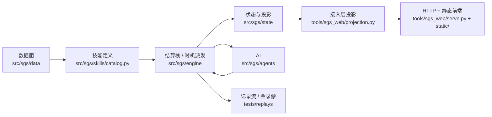

# SGS · 《三国杀》规则引擎与网页牌桌

A state-machine rules engine for *Sanguosha* (三国杀), with a heuristic AI and a pure-static
browser table. Python 3.14 · no build step · one gate (`bash tests/run_all.sh`).

[](LICENSE)
[](pyproject.toml)
[](https://github.com/wangwenhao020913-commits/sgs/actions/workflows/ci.yml)

> **非官方同人项目**：与游卡桌游无隶属、无授权；素材与规则文本的版权见 [`NOTICE`](NOTICE)。
> 只做学习与研究，不提供规则裁定，不用于商业用途。

## 这是什么

一个把《三国杀》的**结算规则**当成状态机来写的项目：引擎侧是「时机派发 + 结算栈 + 询问/响应」
的骨架，接一层纯派生投影给网页，前端是**零构建**的普通脚本（`<script src>` 顺序就是运行顺序，
没有 npm / 打包 / ES module）。

- **规则引擎**（`src/sgs/`）：217 条技能 / 装备定义、103 个武将版本（68 名武将，标准版 + 山 /
  风 / 火 / 雷 / 林 / SP / 一将成名 / 界限突破 / 自制包混池）、身份局与 2 人无身份局、
  标准 108 / 军争 160 两档牌堆。
- **网页牌桌**（`tools/sgs_web/`）：水墨牌桌、技能墨字、属性伤害 / 铁索 / 阵亡 / 体力演出、
  事件流三档、回放页、挂起询问的十余种专用面（选项 / 亮牌 / 排列 / 分配 / 化身外观组件…）。
- **AI**（`src/sgs/agents/`）：启发式（记牌、斩杀、身份推断）与随机基线两档，另有一套离线
  评估与版本台账（`docs/agents/ai-versions.md`）。
- **测试**：`bash tests/run_all.sh` 一条命令跑完**全部**门禁（9 条 shell 校验 + 4000+ 条 pytest，
  本机约 8 分钟），其中 47 条标准对局的**金录像逐字节冻结**。

## 直接玩（Windows，不用装环境）

[**Releases**](https://github.com/wangwenhao020913-commits/sgs/releases) 里下载 `SGS-win64-*.zip`，
解压后双击 `SGS.exe`：控制台窗口起来、浏览器自动打开开局页。首次运行 Windows 会提示
「已保护你的电脑」（exe 没有代码签名）→「更多信息」→「仍要运行」。

数据（录像 / 将池存档 / 日志）在 `%LOCALAPPDATA%\SGS`，删掉包目录加它即彻底卸载：不写注册表、
不联网、不装服务。打包配方与自检在 [`packaging/`](packaging/README.md)。下面是**从源码**跑的路。

## 快速开始

需要 **Linux / macOS / WSL**（门禁是 bash + `.venv/bin/` 路径，Windows 原生跑不了）、
**Python 3.14+**、**Node 20+**（只给前端烟测用）。

```bash
git clone <this-repo> && cd sgs
bash tools/setup-dev.sh          # 换行口径 + git hook + .venv（pydantic / pytest）+ 环境预检
bash tools/serve-dev.sh start    # 起本地服务，打印 URL（缺省 http://127.0.0.1:8100/）
```

浏览器打开上面那个地址 → 选人数 / AI 档位 / 牌堆 → 「开始对局」。

不想起网页也能用命令行跑一局（`setup-dev.sh` 会装出这个入口）：

```bash
.venv/bin/sgs --players 5 --ai heuristic      # 跑一局并打印事件流
.venv/bin/sgs --players 2 --heroes guanyu,zhouyu --seed 7
```

## 目录地图

| 路径 | 是什么 |
|---|---|
| `src/sgs/engine/` | 结算栈、帧与步骤、时机派发、死亡 / 胜利判定 |
| `src/sgs/state/` | 状态模型、询问协议（`Query` / `Answer`）、投影 |
| `src/sgs/skills/` | 技能定义（`catalog.py` 是唯一登记处）+ 各族技能实现 + 数据表 |
| `src/sgs/data/` | 牌堆 / 武将 / 效果原语；`files/*.json` 是数据面 |
| `src/sgs/agents/` | 启发式与随机 AI |
| `tools/sgs_web/` | 接入层：`serve.py`（HTTP）、`projection.py`（可见面 / 唯一过滤点）、`static/`（前端） |
| `tests/` | 门禁：`run_all.sh` 是**唯一**入口；`replays/*.jsonl` 是金录像 |
| `tools/` | 运维小工具：`setup-dev.sh` / `serve-dev.sh` / `check_goldens.sh` / `check_env.sh` / `acceptance_seed.py` … |
| `docs/agents/` | 给协作者（含 AI agent）的导航：前端地图、验收配方、AI 适配契约、技能撰写手册 |
| `开发文档/` | 01–06：总体设计、引擎设计、数据模型、AI 与交互、测试策略、里程碑与风险 |

## 架构



三条贯穿全仓的纪律：**一个事实一个落点**（投影是唯一的过滤点、`CATALOG` 是唯一的技能登记处）、
**唯一门禁**（`tests/run_all.sh`；`.githooks` 在提交时自动跑，CI 只是它的调用方）、
**记录流可回放**（47 条标准金录像逐字节冻结，行为改动必须显式重录并说明）。

## 开发

```bash
bash tests/run_all.sh            # 全量门禁（≈8 分钟）
.venv/bin/pytest tests/test_web.py -q     # 迭代时跑单文件
bash tests/smoke-web.sh          # 前端快回路（起临时服务 + 跑真前端脚本，60–70 s）
```

提交时 `.githooks/pre-commit` 会按受影响路径自动跑门禁（`src/` `tests/` → 全量，文档 → 快速文档
检查）；`git merge` 走同源的 `pre-merge-commit`。CI（`.github/workflows/ci.yml`）在 GitHub 上跑
**同一条**门禁，不另立第二套判据。详见 [`AGENTS.md`](AGENTS.md) 与 [`CODING_STANDARDS.md`](CODING_STANDARDS.md)。

想加武将 / 技能：先读 `docs/agents/skill-authoring.md`（六问流水线 + 13 条硬停判据）。
想自己做一个武将：先读 `docs/agents/diy-heroes.md`——从选路、把入口 skill 装进你的 agent，
到要改哪几个文件、跑什么门禁、版权边界都在那一份。**只改数据**就能做武将：复用 `CATALOG`
里已登记的技能（含别的武将名下的，用显式 `skill_id`，见该文档第 1 节的「诚实边界」）；
要一条**新技能**才必须写 `SkillDef`。
想改网页：先读 `docs/agents/frontend-map.md`。

## 许可与免责

- **代码与原创文档**：[MIT](LICENSE)。
- **游戏素材 / 规则文本**：版权归游卡桌游及各自权利人，本仓库仅作研究引用，**不得商用**；
  详见 [`NOTICE`](NOTICE)。权利人要求移除时，提 Issue 即可。
- 本项目**不是**官方产品，不提供规则裁定；对局结果仅供学习参考。
